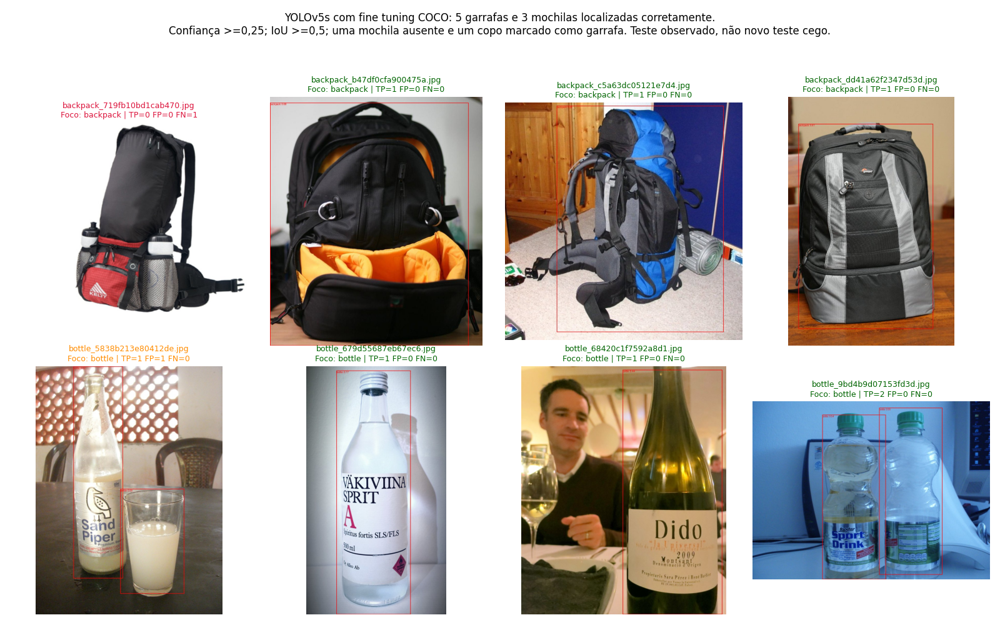

# Melhoria do detector — executada e verificada

## 15. Melhoria complementar — resultados reais

Executada em 13/10/2026 após autorização do aluno para GPU T4 e pesos COCO,
sem contratação de recursos pagos. **As duas classes foram demonstradas com
caixas de classe correta e IoU >=0,5**, a confiança mínima 0,25, no teste observado.

Esta seção usa **fine tuning COCO**, separado dos experimentos obrigatórios
do zero, cujos resultados e outputs foram preservados. YOLOv5s oficial v7.0,
640, batch16, seed42, patience0, mesmos dados/labels/splits Make Sense.
O dataset foi extraído para SSD Colab e conferido por SHA-256/fingerprint.

| Experimento | Melhor época | mAP50 val | mAP50:95 val | Treino (s) |
|---|---:|---:|---:|---:|
| Transfer 30 | 28 | 0.970000 | 0.700620 | 148.13 |
| Transfer 60 | 58 | 0.925560 | 0.705120 | 234.43 |

Escolha exclusiva por validação: **60 épocas**, checkpoint da
época **58**. No teste: mAP50 **0.995000**,
mAP50:95 **0.759696**. Critério de seleção e limiares foram fixados
antes do teste, sem renomear classes ou escolher limiares pelos acertos do teste.

Acertos por classe a confiança >=0,25 e associação única por IoU >=0,5:

| Classe | TP | FP | FN | Imagens com caixa correta / imagens da classe |
|---|---:|---:|---:|---:|
| bottle | 5 | 1 | 0 | 4/4 |
| backpack | 3 | 0 | 1 | 3/4 |

Média/mediana de inferência: **27.51/
28.23 ms**. Oito imagens comuns; warm-up 1 excluído.
Precision/recall oficiais de AP e contagens ao limiar fixo têm definições diferentes.
Labels de foco não cobrem todos os objetos incidentais: isso limita a interpretação
de falsos positivos. O teste já foi visto no experimento anterior; esta é uma
**avaliação complementar retrospectiva**, não um novo teste cego nem prova de
generalização ampla. Base pequena: sucesso nestas imagens não garante todos os cenários.

A inicialização COCO produziu grande ganho de validação com os mesmos dados,
compatível com a hipótese de que o treino curto do zero estava limitado.
Não é uma comparação que isola apenas a inicialização: a leitura dos dados e
o ambiente de execução complementar foram registrados separadamente.
Referência: [treinamento oficial](https://docs.ultralytics.com/yolov5/tutorials/train-custom-data).

Controles externos foram resetados False após a execução, mantendo outputs reais.
Runs e checkpoints ficam no Drive em experiments/fase6_transfer_001.
Resultados pequenos e auditoria em results/yolo_improved. [Assistir ao vídeo de apresentação](https://youtu.be/xQRzp8BzaPY) — **4min34s**, publicação **não listada**. URL, título, duração e indicador de visibilidade conferidos na página do YouTube em 13/10/2026. A conferência de metadados não constitui uma revisão integral do conteúdo do vídeo.

A preparação/testes locais de IoU e controles constam em validation.md. Não houve alterações nos labels ou nova rotulação.

Commit sugerido: `feat(fase6): melhora deteccao das duas classes com fine tuning validado`.

### Falhas preservadas e diagnóstico

`backpack_719fb10bd1cab470.jpg` ficou sem detecção a confiança 0,25.
Em `bottle_5838b213e80412de.jpg`, o copo foi classificado incorretamente como
bottle (confiança 0,5515), além da detecção correta da garrafa.
O painel usa vermelho para ausência da classe de foco e laranja para FP.
mAP50 alto não significa todas as caixas corretas a um limiar fixo: a avaliação
oficial usa limiar inicial 0,001 e AP considera a ordenação por confiança.

No diagnóstico COCO da **validação** sem filtro e a confiança 0,05, apareceram
mochilas com confiança 0,1821/0,2112/0,2383, abaixo de 0,25, e previsões suitcase
nas imagens de foco backpack. Isso apoia a hipótese de baixa confiança e
confusão de classes nessa validação; não comprova a causa de cada falha do teste.
Nenhuma classe suitcase/handbag foi renomeada para backpack na avaliação.

Checkpoint para uso do modelo melhorado:
`/content/drive/MyDrive/Faculdade/Fiap/Fase6/experiments/fase6_transfer_001/runs/transfer_60_epochs/weights/best.pt`.
Use load_improved_yolo e as funções de inferência da seção 15. Pesos não são versionados.
O benchmark ampliado está em results/yolo_improved/comparison/benchmark_with_improvement.csv:
os três resultados originais mais o detector complementar, sem substituir o histórico.
Medições em sessões T4 distintas, entradas e tarefas diferentes; não são ranking universal.
