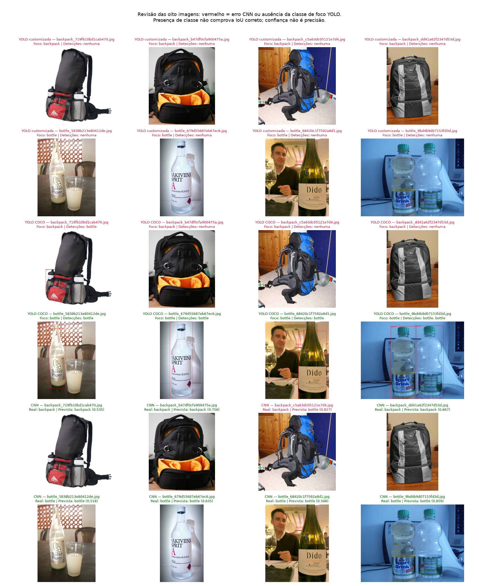

# Resultados reais — sessão fase6_final_001

Data: 13/10/2026. Treinamentos e inferências executados no Colab, Tesla T4.
Os 41 arquivos do pacote original foram conferidos por CRC e SHA-256; suas
métricas e tempos permanecem inalterados. A revisão qualitativa posterior usa
somente esses resultados e foi realmente executada em Jupyter local Python 3.11.

## Análise

| Experimento | Melhor época | mAP@0.5 em validação | mAP@0.5:0.95 em validação | Treino (s) |
|---|---:|---:|---:|---:|
| YOLO 30 épocas | 30 | 0,00096376 | 0,000096376 | 165,22 |
| YOLO 60 épocas | 59 | 0,13642 | 0,040407 | 294,21 |

A configuração foi equivalente, mudando apenas épocas e nome (o diretório
deriva do nome). A validação selecionou **60 épocas**, antes de avaliar o teste.
O checkpoint selecionado obteve **mAP@0.5 = 0,013059** e
**mAP@0.5:0.95 = 0,005039** no teste. O ganho na validação não demonstrou boa
generalização no teste reservado. As curvas oscilaram; oito imagens de validação
e oito de teste não sustentam conclusões amplas sobre overfitting ou qualidade.

A inferência customizada não produziu detecções com confiança mínima de 0,25.
A avaliação oficial usa limiar 0,001 e calcula AP variando limiares, explicando
a coexistência de mAP pequeno positivo e nenhuma caixa nas imagens ilustrativas.
Referências: [val.py v7.0](https://github.com/ultralytics/yolov5/blob/v7.0/val.py) e
[AutoShape v7.0](https://github.com/ultralytics/yolov5/blob/v7.0/models/common.py).

A COCO detectou garrafas nas quatro imagens de foco bottle, sem detecção de
mochila nas quatro backpack. A garrafa em `backpack_719fb10bd1cab470.jpg` é um
objeto incidental real: não deve ser chamada de falso positivo apenas porque
o foco da imagem é mochila. O pipeline não calcula mAP/precision/recall/F1 da
COCO; confiança não representa precisão. Evidência positiva de backpack ficou
**não demonstrada**, sem alterar os parâmetros para fabricar um resultado.

A CNN completou 30 épocas e usou o checkpoint de menor val_loss, época **29**.
No teste classificou **7/8 (accuracy 0,875)**, precision macro **0,9**,
recall macro **0,875** e F1 macro **0,873016**. A matriz (bottle, backpack)
é `[[4,0],[1,3]]`. Errou `backpack_c5a63dc05121e7d4.jpg`, classificando-a como
bottle com confiança 0,826773. A confiança desse erro reforça que não é medida
de correção. Classificação da imagem inteira não demonstra localização de objetos.

| Abordagem | Tarefa | Média por imagem (ms) | Mediana (ms) | Métrica de teste |
|---|---|---:|---:|---|
| YOLO customizada | Detecção, 640 | 34,22 | 35,99 | mAP@0.5:0.95 0,005039 |
| YOLO COCO | Detecção, 640 | 20,97 | 20,22 | mAP indisponível |
| CNN própria | Classificação, 224×224 | 16,99 | 16,30 | Accuracy 0,875 |

Tempos são descritivos desta T4: uma inferência por imagem, warm-up 1,
sem carga do modelo, leitura, warm-up ou salvamento; incluem pré-processamento
e execução/NMS. Entradas, frameworks e tarefas diferem, portanto não há ranking
universal de velocidade ou comparação numérica de accuracy com mAP.
O tempo YOLO inclui subprocesso oficial, validações e checkpoint; CNN mede fit
com validação/checkpoint, excluindo construção. CNN: 39,79 s de treino.
COCO é mais direta de integrar; YOLO própria exige caixas e treinamento;
CNN exige classe única e não fornece localização.

A base de 80 imagens e a revisão assistida de anotações no Make Sense limitam as conclusões.
Mais imagens diversas, revisão independente e novos experimentos previamente
definidos são trabalhos futuros; não foram executados nesta rodada.
Pesos/runs permanecem privados no Drive. [Assistir ao vídeo de apresentação](https://youtu.be/xQRzp8BzaPY) — **4min34s**, publicação **não listada**. URL, título, duração e indicador de visibilidade conferidos na página do YouTube em 13/10/2026. A conferência de metadados não constitui uma revisão integral do conteúdo do vídeo.

## Rastreabilidade e recuperação

Veja `results/audit/final_audit.json` e `return_manifest_original.json`.
Os YAMLs oficiais de opções só diferem em epochs, name e save_dir. CSVs têm
30/60 linhas de épocas; callbacks oficiais registraram melhores épocas 30/59.
`execution.json` e hashes dos checkpoints identificam a origem dos resumos.
A coleta do treino de 30 épocas falhou inicialmente por um NameError; o treino
estava completo. A duração original de perf_counter foi recuperada do frame
da chamada, persistida e conferida, sem estimativa ou novo treinamento.
O coletor agora importa math localmente e salva a duração antes de coletar.

`results/` inclui 16 imagens de inferência YOLO, tabelas, curvas, matriz de
confusão e painel qualitativo. Verde no painel indica presença da classe de
foco ou classificação correta; não comprova IoU correto da caixa.
Os três pipelines usam os mesmos oito nomes listados na auditoria.

O notebook mantém outputs reais e controles externos False após consolidação.
As contagens de execução são de sessões/reexecuções reais, não uma sequência
artificial. Não houve novo treinamento durante a consolidação.

A revisão Make Sense documenta também uma representação impressa de garrafa
em bottle_084b363c71a7f958.jpg e uma candidata a mochila com rodinhas em
backpack_b33b34153db3acdd.jpg, ambas do treino. Foram preservadas da seleção
original; são limitações do dataset, assim como a anotação de objetos de foco
sem cobertura exaustiva dos objetos incidentais. Consulte makesense_validation.md.

## Atualização complementar

## 15. Melhoria complementar — resultados reais

Executada em 13/10/2026 após autorização do aluno para GPU T4 e pesos COCO,
sem contratação de recursos pagos. **As duas classes foram demonstradas com
caixas de classe correta e IoU >=0,5**, a confiança mínima 0,25, no teste observado.

Esta seção usa **fine tuning COCO**, separado dos experimentos obrigatórios
do zero, cujos resultados e outputs foram preservados. YOLOv5s oficial v7.0,
640, batch16, seed42, patience0, mesmos dados/labels/splits Make Sense.
O dataset foi extraído para SSD Colab e conferido por SHA-256/fingerprint.

| Experimento | Melhor época | mAP50 val | mAP50:95 val | Treino (s) |
|---|---:|---:|---:|---:|
| Transfer 30 | 28 | 0.970000 | 0.700620 | 148.13 |
| Transfer 60 | 58 | 0.925560 | 0.705120 | 234.43 |

Escolha exclusiva por validação: **60 épocas**, checkpoint da
época **58**. No teste: mAP50 **0.995000**,
mAP50:95 **0.759696**. Critério de seleção e limiares foram fixados
antes do teste, sem renomear classes ou escolher limiares pelos acertos do teste.

Acertos por classe a confiança >=0,25 e associação única por IoU >=0,5:

| Classe | TP | FP | FN | Imagens com caixa correta / imagens da classe |
|---|---:|---:|---:|---:|
| bottle | 5 | 1 | 0 | 4/4 |
| backpack | 3 | 0 | 1 | 3/4 |

Média/mediana de inferência: **27.51/
28.23 ms**. Oito imagens comuns; warm-up 1 excluído.
Precision/recall oficiais de AP e contagens ao limiar fixo têm definições diferentes.
Labels de foco não cobrem todos os objetos incidentais: isso limita a interpretação
de falsos positivos. O teste já foi visto no experimento anterior; esta é uma
**avaliação complementar retrospectiva**, não um novo teste cego nem prova de
generalização ampla. Base pequena: sucesso nestas imagens não garante todos os cenários.

A inicialização COCO produziu grande ganho de validação com os mesmos dados,
compatível com a hipótese de que o treino curto do zero estava limitado.
Não é uma comparação que isola apenas a inicialização: a leitura dos dados e
o ambiente de execução complementar foram registrados separadamente.
Referência: [treinamento oficial](https://docs.ultralytics.com/yolov5/tutorials/train-custom-data).

Controles externos foram resetados False após a execução, mantendo outputs reais.
Runs e checkpoints ficam no Drive em experiments/fase6_transfer_001.
Resultados pequenos e auditoria em results/yolo_improved. Vídeo publicado: [YouTube](https://youtu.be/xQRzp8BzaPY), 4min34s, não listado.

### Falhas preservadas e diagnóstico

`backpack_719fb10bd1cab470.jpg` ficou sem detecção a confiança 0,25.
Em `bottle_5838b213e80412de.jpg`, o copo foi classificado incorretamente como
bottle (confiança 0,5515), além da detecção correta da garrafa.
O painel usa vermelho para ausência da classe de foco e laranja para FP.
mAP50 alto não significa todas as caixas corretas a um limiar fixo: a avaliação
oficial usa limiar inicial 0,001 e AP considera a ordenação por confiança.

No diagnóstico COCO da **validação** sem filtro e a confiança 0,05, apareceram
mochilas com confiança 0,1821/0,2112/0,2383, abaixo de 0,25, e previsões suitcase
nas imagens de foco backpack. Isso apoia a hipótese de baixa confiança e
confusão de classes nessa validação; não comprova a causa de cada falha do teste.
Nenhuma classe suitcase/handbag foi renomeada para backpack na avaliação.

